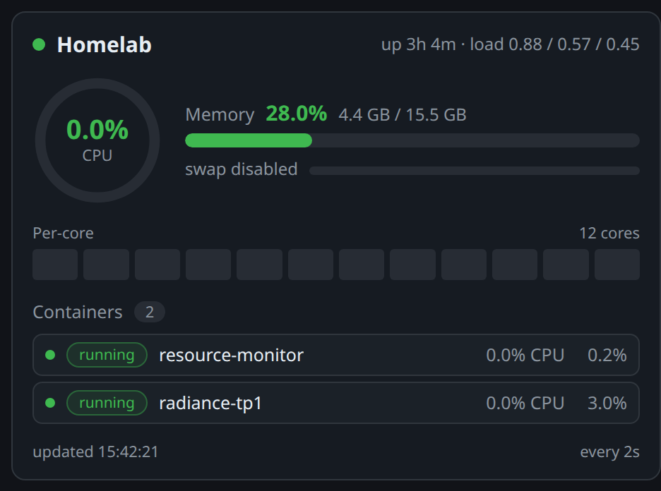

# Resource Monitor Card

A dependency-free Lovelace card for Home Assistant that shows live host CPU,
memory, swap and Docker container stats from the
[System Monitor](https://github.com/etanyxyz/System-Monitor) service.

Want the same data as native Home Assistant sensors (devices, history,
automations)? Install the companion
[System Monitor integration](https://github.com/etanyxyz/System-Monitor-HA-Integration).

[](https://github.com/hacs/integration)
[](https://github.com/etanyxyz/System-Monitor-HA-Card/releases)
[](LICENSE)



- **CPU**: ring gauge for overall load plus per-core bars and load averages
- **Memory / swap**: usage bars with used / total and percentages
- **Containers**: state badge (running, paused, exited, unhealthy…), CPU % and
  memory per container, straight from the Docker Engine API
- **Zero dependencies**: one plain-JS file, no imports, no build step
- Theme-aware, but tuned for the dark GitHub palette the monitor itself uses

## Requirements

A running [System Monitor](https://github.com/etanyxyz/System-Monitor) instance
reachable from your browser. The monitor is built from source — it has no
published image:

```bash
git clone https://github.com/etanyxyz/System-Monitor.git
cd System-Monitor
docker compose up -d --build     # hardened container, port 1010
```

Check it answers `http://<host>:1010/api/system` in the browser first.

The monitor must be a build that includes the CORS middleware (every commit
since the Home Assistant support landed) — older builds send no CORS headers,
so the browser cannot read the API from a dashboard. Rebuild with
`docker compose up -d --build` after pulling.

## Installation

### Marketplace (Home Assistant 2026.11+) / HACS

1. Add `https://github.com/etanyxyz/System-Monitor-HA-Card` as a custom
   repository with category **Dashboard**:
   - **Marketplace**: Settings → Marketplace → repositories → add from link
   - **HACS**: HACS → three-dot menu → **Custom repositories**
2. Install **Resource Monitor Card**. The store registers the dashboard
   resource itself (versioned URL, so updates are picked up).
3. Reload your dashboard; hard-refresh the browser (Ctrl/Cmd+Shift+R) the
   first time so the new resource is loaded.

### Manual

1. Copy `resource-monitor-card.js` into `config/www/`
2. Settings → Dashboards → three-dot menu → **Resources** → **Add resource**
   - URL: `/local/resource-monitor-card.js`
   - Type: **JavaScript module**

## Configuration

Add the card (or paste YAML):

```yaml
type: custom:resource-monitor-card
url: http://192.168.1.50:1010
```

| Option | Required | Default | Description |
| --- | --- | --- | --- |
| `url` | **yes** | — | Base URL of the monitor. `http://` is assumed when omitted. |
| `token` | no | — | Value of `MONITOR_TOKEN` on the monitor, sent as `?token=`. |
| `interval` | no | `5` | Poll interval in seconds (2–60). |
| `title` | no | `System Monitor` | Card title. |
| `max_containers` | no | `12` | Maximum container rows shown (1–50). |

Full example:

```yaml
type: custom:resource-monitor-card
url: http://192.168.1.50:1010
token: my-secret
interval: 10
title: Homelab
max_containers: 8
```

The card has a **visual editor** (Edit card → shows URL, token, interval, title
and container-limit fields), so YAML is optional.

### Using a token

If the monitor runs with `MONITOR_TOKEN` set, put the same value in `token:`.
The card sends it both as `?token=` and as an `Authorization: Bearer` header.
The query parameter is what survives reverse proxies that strip authorization
headers, and it is also how the monitor's own dashboard authenticates.

> **Note on CORS:** any website that can reach your monitor can read the same
> data once it knows the URL (and the token, if one is set). If the monitor is
> exposed beyond your LAN, set `MONITOR_TOKEN` and put the card/monitor behind
> HTTPS.

## How it works

The card polls two read-only endpoints on the monitor:

- `GET /api/system` — CPU, per-core load, memory, swap, uptime
- `GET /api/containers` — one entry per Docker container (state, health,
  image, CPU %, memory usage/limit)

Nothing else is requested, and the monitor itself only exposes GET endpoints
over a read-only Docker socket mount.

## License

MIT — see [LICENSE](LICENSE).
